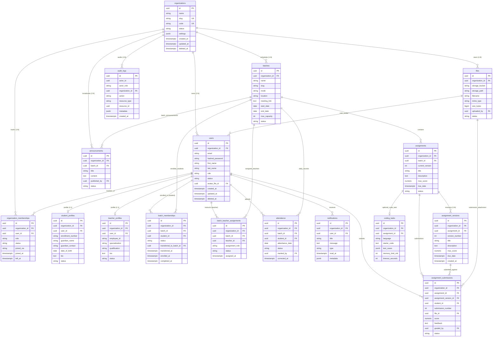

# Entity-Relationship Diagram (ERD) & Schema Documentation

**Project:** Multi-Tenant Learning & Coaching Management SaaS  
**Version:** 1.0  
**Date:** 2026-11-05  
**Schema Status:** Production-Oriented Baseline (Phase 1 Database Foundation)

---

## 1. Visual Entity-Relationship Diagram (Mermaid)

---

## 2. Table-by-Table Schema Specification

### 2.1 `organizations`
- **Scope**: Platform Root / Tenant Anchor
- **Purpose**: Represents an independent tenant institution, academy, or coaching center.
- **Key Fields**:
  - `id`: Non-guessable UUID primary key (`gen_random_uuid()`).
  - `slug`: URL-safe tenant identifier (e.g., `acme-academy`). Unique globally across the system.
  - `code`: Secret enrollment code for self-registration (Decision Q2-C). Unique globally.
  - `status`: Lifecycle state (`active`, `suspended`, `archived`).
  - `deleted_at`: Soft-delete timestamp.
- **Constraints**:
  - `PRIMARY KEY (id)`
  - `UNIQUE (slug)`
  - `UNIQUE (code)`
  - `CHECK (status IN ('active', 'suspended', 'archived'))`

### 2.2 `users`
- **Scope**: Tenant-Owned Entity
- **Purpose**: Represents a user account. Per Decision Q1-A, a user belongs to exactly one organization.
- **Key Fields**:
  - `id`: UUID primary key.
  - `organization_id`: Foreign key referencing `organizations.id`. Enforces single-tenant identity.
  - `email`: Normalized email string.
  - `role`: Role enum (`admin`, `teacher`, `student`).
  - `status`: Account state (`active`, `inactive`, `suspended`, `deleted`).
  - `deleted_at`: Supports the 1-day retention purge queue (Decision Q12).
- **Constraints**:
  - `PRIMARY KEY (id)`
  - `FOREIGN KEY (organization_id) REFERENCES organizations(id) ON DELETE RESTRICT`
  - `UNIQUE (organization_id, email)` — Tenant-scoped email uniqueness.
  - `CHECK (role IN ('admin', 'teacher', 'student'))`
  - `CHECK (status IN ('active', 'inactive', 'suspended', 'deleted'))`

### 2.3 `organization_memberships`
- **Scope**: Tenant-Owned Entity
- **Purpose**: Auditable history of when a user joined or left an organization, including joining method.
- **Constraints**:
  - `PRIMARY KEY (id)`
  - `UNIQUE (organization_id, user_id)`
  - `FOREIGN KEY (organization_id) REFERENCES organizations(id) ON DELETE RESTRICT`
  - `FOREIGN KEY (user_id) REFERENCES users(id) ON DELETE CASCADE`
  - `CHECK (role IN ('admin', 'teacher', 'student'))`
  - `CHECK (status IN ('active', 'inactive', 'suspended', 'left', 'transferred'))`
  - `CHECK (joined_via IN ('code', 'admin_invite', 'system'))`

### 2.4 `student_profiles` & `teacher_profiles`
- **Scope**: Tenant-Owned Entities
- **Purpose**: Role-specific attributes separated from authentication identity.
- **Constraints**:
  - `UNIQUE (organization_id, user_id)` — Guarantees 1:1 profile per user per organization.
  - `UNIQUE (organization_id, enrollment_number)` — Tenant-scoped enrollment ID uniqueness.
  - `UNIQUE (organization_id, employee_id)` — Tenant-scoped employee ID uniqueness.

### 2.5 `batches`
- **Scope**: Tenant-Owned Entity
- **Purpose**: Cohorts or classes running learning programs.
- **Key Fields**:
  - `mode`: Delivery mode (`offline`, `online`, `hybrid`) per Decision Q17.
  - `location`: Physical classroom or venue.
  - `meeting_link`: Virtual classroom URL (Google Meet/Zoom) for remote/hybrid sessions.
  - `max_capacity`: Maximum allowable student enrollment.
- **Constraints**:
  - `UNIQUE (organization_id, slug)`
  - `CHECK (mode IN ('offline', 'online', 'hybrid'))`
  - `CHECK (max_capacity IS NULL OR max_capacity > 0)`

### 2.6 `batch_memberships`
- **Scope**: Tenant-Owned Entity
- **Purpose**: Tracks student enrollment in a batch, including transfers (Decision Q4).
- **Transfer Behavior**:
  - When transferring to another batch, `status` becomes `'transferred'`, `transferred_to_batch_id` records destination, and a new record is created in the destination batch.
- **Constraints**:
  - `UNIQUE (organization_id, batch_id, student_id)` — Prevents duplicate enrollments in the same batch.
  - `CHECK (status IN ('active', 'completed', 'transferred', 'dropped'))`

### 2.7 `batch_teacher_assignments`
- **Scope**: Tenant-Owned Entity
- **Purpose**: Maps instructors to batches with designated responsibilities (`primary`, `assistant`, `substitute`).
- **Constraints**:
  - `UNIQUE (organization_id, batch_id, teacher_id)`

### 2.8 `attendance`
- **Scope**: Tenant-Owned Entity
- **Purpose**: Daily attendance tracking with idempotent writes and retroactive correction support (Decision Q5).
- **Key Fields**:
  - `attendance_date`: Specific calendar date of the session.
  - `marked_by`: User ID of instructor/admin who took attendance.
  - `corrected_at`: Timestamp recording when a correction was made.
- **Constraints**:
  - `UNIQUE (organization_id, batch_id, student_id, attendance_date)` — Enables idempotent upserts (`ON CONFLICT DO UPDATE`).
  - `CHECK (status IN ('present', 'absent', 'late', 'excused'))`

### 2.9 `assignments` & `assignment_versions`
- **Scope**: Tenant-Owned Entities
- **Purpose**: Preserves trustworthy assignment specifications across updates (Decision Q6 & Q7).
- **Versioning Mechanism**:
  - `assignments` stores the mutable header (`status`, `due_date`, `current_version`).
  - `assignment_versions` stores immutable snapshots of the specification at each revision.
  - Edits increment `current_version` and insert an immutable `assignment_versions` record.
- **Constraints**:
  - `assignments`: `CHECK (max_score > 0)`, `CHECK (status IN ('draft', 'published', 'closed', 'archived'))`
  - `assignment_versions`: `UNIQUE (assignment_id, version_number)`, `CHECK (max_score > 0)`

### 2.10 `assignment_submissions`
- **Scope**: Tenant-Owned Entity
- **Purpose**: Student submission history linked to the specific assignment version they completed.
- **Key Fields**:
  - `assignment_version_id`: Exact revision submitted against.
  - `submission_number`: Resubmission counter (1, 2, ...).
  - `file_id`: Reference to uploaded submission artifact in `files`.
  - `graded_by`: Teacher who graded the work (Decision Q8).
- **Constraints**:
  - `UNIQUE (organization_id, assignment_id, student_id, submission_number)`
  - `CHECK (score IS NULL OR score >= 0)`
  - `CHECK (status IN ('submitted', 'graded', 'returned', 'resubmitted'))`

### 2.11 `files`
- **Scope**: Tenant-Owned Entity
- **Purpose**: Metadata registry for file assets stored in Supabase Storage.
- **Constraints**:
  - `CHECK (size_bytes > 0 AND size_bytes <= 4194304)` — **PostgreSQL level 4 MiB size limit** (Decision Q11).
  - `UNIQUE (organization_id, storage_bucket, storage_path)`

### 2.12 `notifications`
- **Scope**: Tenant-Owned Entity
- **Purpose**: In-app notifications per Decision Q10.
- **Constraints**:
  - `CHECK (type IN ('progress', 'assignment', 'attendance', 'announcement', 'system'))`
- **Performance**: Partial index on `WHERE read_at IS NULL` for instant unread badge counts.

### 2.13 `audit_logs`
- **Scope**: Global Entity (`organization_id` is nullable for cross-tenant/platform events)
- **Purpose**: Append-only audit ledger for compliance and forensics.
- **Properties**:
  - No `updated_at` or `deleted_at`.
  - Application database user only receives `INSERT` and `SELECT` permissions.

